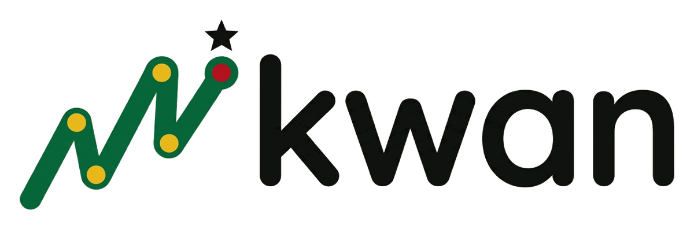

<p align="center">
  <picture>
    <source media="(prefers-color-scheme: dark)" srcset="https://raw.githubusercontent.com/rofyray/kwan/main/docs/assets/kwan-logo-dark.png">
    
  </picture>
</p>

<p align="center">
  <a href="https://pypi.org/project/kwan/"></a>
  <a href="https://pypi.org/project/kwan/"></a>
  <a href="https://github.com/rofyray/kwan/actions/workflows/ci.yml"></a>
  <a href="https://rofyray.github.io/kwan/"></a>
  <a href="https://huggingface.co/spaces/rofyray/kwan"></a>
  <a href="https://github.com/rofyray/kwan/blob/main/LICENSE"></a>
</p>

# Kwan

**Kwan** is Twi for *path* (*ɔkwan*). It tells a Ghanaian pupil which maths skill to learn next, explains why, and sets the practice in everyday Ghanaian life.

Kwan is an open-source learning path engine for the NaCCA Standards-Based Curriculum, Mathematics, Basic 1 to Basic 6. It is a Python package with a command-line tool, a learner-state store and an optional REST API, plus a public demo.

- **Live demo:** https://huggingface.co/spaces/rofyray/kwan (a Gradio app, redeployed with each release)
- **Documentation:** https://rofyray.github.io/kwan/ (the same pages are in [`docs/`](docs/index.md))
- **Package:** https://pypi.org/project/kwan/ (`uv add kwan` or `pip install kwan`)

Kwan uses the NaCCA Standards-Based Curriculum to organise skills. Kwan is not reviewed, approved or endorsed by NaCCA or the Ministry of Education.

## Why we built it

Most learning apps and AI tutors used across Africa were designed somewhere else. Their word problems feature snow days and prices in dollars, and the order of topics follows a foreign syllabus. A child in a village somewhere in Ghana has to decode the story before she can start on the maths, and that extra step is where many children stop.

Kwan starts from what Ghanaian pupils already study. Its skill map is the NaCCA Standards-Based Mathematics Curriculum for Basic 1 to Basic 6, the same document teachers plan their lessons from, so a recommendation lines up with the lesson on the blackboard. Each recommended skill comes with a setting a Ghanaian child will recognise: sharing groundnuts, giving change for kenkey and fish, continuing a kente pattern, working out a trotro fare.

## What it does

The map today, counted by the build scripts:

<!-- RESULTS:START id=readme-counts source=data/eval_results.json -->
276 NaCCA learning indicators linked by 295 prerequisite connections.
<!-- RESULTS:END -->

1. **Maps the curriculum.** Every learning indicator in NaCCA Mathematics B1 to B6 is a skill on a map, with its strand and sub-strand names and a short label written for Kwan. Links say which skills come before which, and every link records where it came from.
2. **Tracks the pupil.** After each answer, Kwan updates its estimate of how well the pupil knows every skill. Evidence flows along the map, so doing well on a skill also raises the estimate for the skills that build on it. When answers carry a time, skills that are not practised fade, and a question can carry its own difficulty.
3. **Picks the next skills.** Kwan looks for skills whose foundations are in place and that sit at a productive level of challenge. If the teacher sets a goal, skills on the path to the goal come first. One place in the list can go to a skill the pupil learned before and is starting to forget. Picks vary across strands, and a little seeded exploration can be switched on.
4. **Explains each pick** in plain language, from the same signals that produced the ranking. The reason comes as a sentence and as parts with keys, so it can be shown in another language. Example: *"Builds on B2.1.1.1.6, where you are at 74%. You are at 62%, close enough to master with practice. Opens the way to 46 later skills."*
5. **Grounds it in Ghana.** *"Try it in Ghana: Use 1 cedi and 2 cedi coins to make 5 cedis in as many ways as you can."* Settings are written to a [style guide](docs/context-style-guide.md) and shown by default only after a teacher has reviewed them.

Kwan makes no network call and no AI model call when it recommends. It runs on one CPU core, which matters for schools with patchy internet.

## Results

Every number in this section is rendered from [`data/eval_results.json`](data/eval_results.json) by `uv run scripts/fill_docs.py`. Nothing is typed by hand, and a test fails if the README and the file disagree. The [Evidence](docs/evidence.md) page has the same results with more decimals and a reading guide for each table.

### Does the learner model predict the next answer?

How well the learner model predicts a pupil's next answer, tested on students it never saw in training. AUC: 0.5 is a coin flip, 1.0 is perfect. The first two rows are AMMORE, real answers from African pupils; the second row is Ghanaian pupils only.

<!-- RESULTS:START id=readme-kt-table source=data/eval_results.json -->
| Dataset | Answers | Students | Skill average | BKT | Classic Elo | **Kwan** |
| --- | ---: | ---: | ---: | ---: | ---: | ---: |
| AMMORE, all pupils (Ghana, Nigeria, Kenya, South Africa) | 50,507 | 2,388 | 0.631 | not run | 0.690 | **0.774** |
| AMMORE, Ghanaian pupils only | 16,706 | 730 | 0.639 | not run | 0.690 | **0.764** |
| ASSISTments 2009 | 259,399 | 4,163 | 0.624 | 0.700 | 0.668 | **0.755** |
| Eedi 2020, task 3/4 | 1,382,727 | 4,918 | 0.576 | not run | 0.684 | **0.776** |
| Eedi 2020, task 1/2 | 15,867,850 | 118,971 | 0.572 | not run | 0.678 | **0.795** |
| ASSISTments 2012-13 | 2,711,602 | 29,018 | 0.609 | not run | 0.654 | **0.747** |
| ASSISTments 2015 | 683,801 | 19,840 | 0.640 | not run | 0.657 | **0.684** |
| ASSISTments 2017 | 942,816 | 1,709 | 0.586 | not run | 0.628 | **0.710** |
| XES3G5M | 5,549,184 | 18,066 | 0.619 | not run | 0.647 | **0.801** |
| Junyi Academy 2015 (evaluation only) | 25,925,992 | 247,606 | 0.719 | not run | 0.754 | **0.790** |
<!-- RESULTS:END -->

### Ghanaian pupils

AMMORE comes from Rori, a WhatsApp maths tutor used by pupils in Ghana, Nigeria, Kenya and South Africa. Kwan reports the Ghanaian pupils on their own so that a weaker fit for Ghana could not hide inside an average.

<!-- RESULTS:START id=readme-ghana source=data/eval_results.json -->
Kwan's AUC is 0.774 on all AMMORE pupils and 0.764 on the 730 Ghanaian pupils (16,706 answers).

| AMMORE | Pupils | Answers | Skills | Skill average | Classic Elo | **Kwan** |
| --- | ---: | ---: | ---: | ---: | ---: | ---: |
| All pupils | 2,388 | 50,507 | 151 | 0.631 | 0.690 | **0.774** |
| **Ghanaian pupils only** | 730 | 16,706 | 144 | 0.639 | 0.690 | **0.764** |
<!-- RESULTS:END -->

These pupils are older than Kwan's Basic 1 to 6 pupils, and their skills are Rori's, not NaCCA's. See [Limitations](#limitations).

### Does forgetting help, and do tuned parameters help?

Where answers carry dates, a skill's estimate fades when it is not practised. The forgetting time τ and the Elo step sizes were chosen on training students only. Parameters fitted on AMMORE are reported but never shipped, because its licence is non-commercial.

<!-- RESULTS:START id=readme-learner-fit source=data/eval_results.json -->
| Dataset | Has times | Best τ | AUC, v1 steps, no forgetting | AUC, with forgetting | Change | AUC, tuned steps |
| --- | ---: | ---: | ---: | ---: | ---: | ---: |
| ASSISTments 2009 | no | none | 0.752 | 0.752 | 0.000 | 0.754 |
| Eedi 2020, task 3/4 | yes | 30 days | 0.776 | 0.778 | 0.002 | 0.780 |
| Eedi 2020, task 1/2 | yes | 45 days | 0.786 | 0.787 | 0.001 | 0.791 |
| AMMORE (evaluation only) | yes | 14 days | 0.771 | 0.771 | 0.000 | 0.769 |
| ASSISTments 2015 | no | none | 0.684 | 0.684 | 0.000 | 0.687 |
| ASSISTments 2017 | yes | 45 days | 0.710 | 0.712 | 0.002 | 0.715 |
| XES3G5M | yes | 7 days | 0.798 | 0.798 | 0.001 | 0.804 |

Shipped in the maths bundle: `k_s` 0.50, `k_k` 0.30, `decay` 0.02, τ 30 days (step sizes chosen on assistments_2009, eedi_2020_task34, eedi_2020_task12; τ chosen on eedi_2020_task34, eedi_2020_task12).

Held-out students, v1 defaults against the shipped parameters:

| Dataset | AUC, v1 defaults | AUC, shipped | Gain |
| --- | ---: | ---: | ---: |
| ASSISTments 2009 | 0.752 | 0.753 | 0.000 |
| Eedi 2020, task 3/4 | 0.776 | 0.780 | 0.004 |
| Eedi 2020, task 1/2 | 0.786 | 0.790 | 0.005 |
<!-- RESULTS:END -->

### Would a deep model do better?

Deep knowledge tracing models from the pyKT toolkit were trained on the same data and compared with Kwan's Elo on the same folds. The rule for adopting one was fixed before the benchmark ran.

<!-- RESULTS:START id=readme-deep-kt source=data/eval_results.json -->
| Model | ASSISTments 2009 AUC | Eedi task 3/4 AUC | AMMORE AUC | XES3G5M AUC | ms per update (CPU) |
| --- | ---: | ---: | ---: | ---: | ---: |
| **Kwan (multi-level Elo)** | 0.758 ± 0.005 | 0.780 ± 0.004 | 0.773 ± 0.009 | 0.801 ± 0.001 | under 0.01 |
| DKT | 0.750 ± 0.009 | 0.759 ± 0.004 | 0.725 ± 0.012 | not run | 1.76 |
| SAKT | 0.713 ± 0.008 | 0.739 ± 0.005 | 0.696 ± 0.012 | not run | 0.77 |
| simpleKT | 0.739 ± 0.010 | 0.788 ± 0.004 | 0.737 ± 0.010 | not run | 1.36 |
| AKT | 0.712 ± 0.010 | 0.730 ± 0.005 | 0.717 ± 0.009 | not run | 21.87 |

**Decision: Elo stays the default learner model.** No deep model meets rule D7. The closest is simplekt: at least 0.03 AUC ahead of elo-multi (Kwan) on 0 of the 3 D7 datasets it was run on (needs 2); its best margin is +0.0089 on eedi_34. Elo stays the only learner model.

Rule: D7: a deep model is adopted only if it beats elo-multi by at least 0.03 AUC on at least two of AMMORE, Eedi and ASSISTments 2009, and stays under 20 ms per update on CPU.
<!-- RESULTS:END -->

### Does following Kwan help a simulated pupil?

There are no classroom trials yet. What exists is a simulation: virtual pupils with hidden true skills practise under different policies, with forgetting in their hidden state. Kwan is measured against syllabus order, random practice and a "remedial first" rule that uses the map but none of Kwan's scoring.

<!-- RESULTS:START id=readme-simulation-v2 source=data/eval_results.json -->
30 simulated learners per profile and policy (seeds 0 to 29), 150 practice steps at 5 a day, then 30 days without practice; goal runs stop at 300 steps

New skills mastered after 150 practice steps (mean over 30 simulated pupils):

| Pupil profile | **Kwan** | Kwan + exploration | Kwan, top pick only | Syllabus order | Random | Remedial first |
| --- | ---: | ---: | ---: | ---: | ---: | ---: |
| Beginner in Basic 1 | **23.2** | 22.0 | 19.9 | 17.6 | 6.9 | 19.1 |
| Basic 4 pupil with gaps in B1 to B3 | **11.1** | 10.4 | 12.7 | 6.3 | 7.2 | 15.4 |
| Basic 6 pupil with gaps that grew | **9.4** | 8.4 | 8.6 | 5.6 | 8.1 | 12.9 |
| Basic 4 pupil, strong in Number, weak in Geometry | **10.1** | 9.9 | 8.6 | 8.0 | 7.6 | 5.0 |

Of those, skills still known after 30 days without practice:

| Pupil profile | **Kwan** | Kwan + exploration | Kwan, top pick only | Syllabus order | Random | Remedial first |
| --- | ---: | ---: | ---: | ---: | ---: | ---: |
| Beginner in Basic 1 | **17.7** | 17.4 | 14.1 | 10.4 | 4.1 | 11.6 |
| Basic 4 pupil with gaps in B1 to B3 | **8.2** | 7.5 | 9.1 | 4.4 | 3.6 | 9.5 |
| Basic 6 pupil with gaps that grew | **7.2** | 6.0 | 5.9 | 3.2 | 4.4 | 7.3 |
| Basic 4 pupil, strong in Number, weak in Geometry | **7.7** | 7.1 | 6.1 | 5.3 | 4.3 | 3.3 |

Checks set before the run: kwan strict beats syllabus and random on gapped profiles: yes; kwan strict within 1 skill of syllabus on every profile: yes. All met: yes.
<!-- RESULTS:END -->

The table from the Round 1 build, with the simpler simulator that never forgets, is kept for comparison:

<!-- RESULTS:START id=readme-simulation-v1 source=data/eval_results.json -->
30 simulated learners x 150 practice steps, NaCCA B1-B6 graph

| Pupil | **Following Kwan** | Syllabus order | Random practice |
| --- | ---: | ---: | ---: |
| P4 pupil with gaps in B1 to B3 | **13.5** | 8.8 | 10.7 |
| Beginner in P1 | **25.2** | 23.7 | 9.7 |
<!-- RESULTS:END -->

Kwan helps most where pupils have gaps. For a beginner, the syllabus order is already a good path, and Kwan roughly matches it. The "remedial first" rule does well for pupils with gaps because it goes straight to the missing foundations, which Kwan's scoring also does, and it does badly for the pupil whose gaps sit in one strand.

**Simulator assumptions**, in the simulator's own words:

<!-- RESULTS:START id=readme-simulation-assumptions source=data/eval_results.json -->
Each simulated pupil has a hidden true state for every skill. One practice step on a skill the pupil does not know teaches it with probability 0.35 when every prerequisite is truly known and 0.03 otherwise. A known skill is answered wrongly 10% of the time and an unknown one is guessed right 20% of the time. The pupil does 5 steps a day. Each night every known skill can be forgotten: a skill with memory strength S days survives one day with probability exp(-1/S). S is 45 days for a skill just learned and 365 days for what the pupil knew at the start; practising a known skill again on a later day doubles S, up to 365 days. Practising a skill does not refresh its prerequisites. These are modelling assumptions, not measurements of Ghanaian pupils.

- `beginner_p1`: ASSUMPTION, not data. A pupil starting Basic 1: knows 15% of the B1 and B2 skills (from home and kindergarten) and 3% of everything later. Same as the v1.0 profile.
- `gapped_p4`: ASSUMPTION, not data. A Basic 4 pupil with foundational gaps: knows 75% of the B1 to B3 skills, so one lower-primary skill in four is missing, and 5% of B4 to B6. Same as the v1.0 profile.
- `gapped_p6`: ASSUMPTION, not data. A Basic 6 pupil with gaps that grew over the years: knows 80% of B1 to B3, 50% of B4 and B5, and 5% of B6.
- `uneven_strands`: ASSUMPTION, not data. A Basic 4 pupil who is strong in Number and weak in Geometry and Measurement: of the B1 to B4 skills, knows 85% in Number, 15% in Geometry and Measurement and 50% in Algebra and Data; knows 5% of B5 and B6 in every strand.
<!-- RESULTS:END -->

These are modelling choices, so treat the simulation as a check on the policy's logic. The real-data results stand on their own.

### Does the goal path work?

<!-- RESULTS:START id=readme-goal-path source=data/eval_results.json -->
With a goal set, 76.7% of the top-3 picks sit on the path to the goal in strict mode (the default) and 36.0% in soft mode (the Round 1 behaviour). Setup: 50 seeded pupils, each with up to 60 answers on B1 to B3 skills (85% right) and a goal drawn from B4 to B6; share of the top 3 recommendations that are on the path to the goal.
<!-- RESULTS:END -->

### Is it fast enough?

<!-- RESULTS:START id=readme-latency source=data/eval_results.json -->
A top-3 recommendation takes 0.10 ms on average and 0.13 ms at the 95th percentile (single CPU core, pure Python; 3,000 timed calls per learner state, in-process, no network).
<!-- RESULTS:END -->

### Is the curriculum data complete?

<!-- RESULTS:START id=readme-curriculum source=data/eval_results.json -->
Indicators parsed: 276 of 276 expected from the hand count (counts match: yes). Descriptions that look cut short: 1 (0.4%). Indicators with at least one exemplar: 276 (100%), 673 exemplars in all, 43 of them set in Ghana. Misprinted codes corrected: 13.

Short labels: 276 drafted, 0 reviewed by a teacher, 0 missing, 0 over 60 characters.
<!-- RESULTS:END -->

<!-- RESULTS:START id=readme-graph source=data/eval_results.json -->
Skill map: 276 skills and 295 prerequisite links (54 bridge, 159 sequence, 82 vertical). No cycles: yes. Every skill reachable: yes. Longest chain: 36 links.
<!-- RESULTS:END -->

### AI-augmented skill links

The rules that build the map follow the order of the curriculum and miss links that cross strands. Kwan asks a decision model one question about a pair of skills, "Must a pupil be able to do A before they can learn B?", tests the method on Junyi Academy data that comes with expert links, and sends every suggestion to a teacher. Only accepted links ship.

<!-- RESULTS:START id=readme-graph-augment source=data/eval_results.json -->
Decision model: local-encoder (all-MiniLM-L6-v2+logreg@50721cd7). Precision bar: 80%. On the Junyi benchmark (held-out exercises) it proposed 13 links, 4 of them expert links: precision 30.8%, recall 1.6%. Meets the bar: no.

On NaCCA Mathematics it scored 5,403 candidate pairs and proposed 4 links. Teacher review: 4 pending, 0 accepted, 0 rejected. Accepted links shipped in the graph: 0.

Teacher acceptance: not yet measured: no teacher has reviewed an edge.
<!-- RESULTS:END -->

The method is built and tested end to end. The local model used so far is below the precision bar, so its few suggestions wait for teacher review, and the shipped map holds rule-based links only. A stronger decision model is the next thing to try.

### Practice settings

<!-- RESULTS:START id=readme-contexts source=data/eval_results.json -->
Practice settings: 828 drafted for 276 of 276 indicators; 828 pass the automatic checks. Reviewed by a teacher: 0 settings, covering 0 indicators (0.0% coverage). Reviewers so far: 0.

Translations for Basic 1 to Basic 3:

| Language | B1 to B3 indicators | Drafts | Reviewed | Indicators shipping |
| --- | ---: | ---: | ---: | ---: |
| Twi | 93 | 0 | 0 | 0 |
| Ewe | 93 | 0 | 0 | 0 |
| Ga | 93 | 0 | 0 | 0 |
<!-- RESULTS:END -->

Until a teacher reviews a setting, Kwan shows the general setting for the skill's strand and class band. The demo has a clearly labelled switch to show the unreviewed drafts.

## Help review it

Kwan is checked by people who teach. If you teach in Ghana, train teachers or work in education, you can review skill links ("Would a pupil really need A before B?"), practice settings and short labels, or Twi, Ewe and Ga translations. No coding is needed: open a ["Teacher review" issue](https://github.com/rofyray/kwan/issues/new?template=teacher-review.yml) and a maintainer will send you a review sheet. The [teacher review guide](docs/teacher-review-guide.md) explains every column, and every reviewer is credited in [`CONTRIBUTORS.md`](CONTRIBUTORS.md).

## How it works

- **Curriculum** (`kwan.curriculum`): downloads the official NaCCA PDFs, reads every indicator with its strand, sub-strand, description and exemplars, corrects misprinted codes, and writes a QA report against a hand count. The repository commits codes, numbers, names and Kwan's own short labels; NaCCA's text stays in a git-ignored build folder.
- **Skill map** (`kwan.graph`): links the next indicator in the same standard, the same standard in the next class, and the next standard in the same sub-strand, each with its provenance. A decision model can propose cross-strand links, which teachers review on a sheet. The map is checked to be a directed acyclic graph.
- **Learner model** (`kwan.learner`): multi-level Elo. The chance of a correct answer is `σ(θ_pupil + θ_pupil,skill − β_item)`. Skills the pupil has not tried borrow evidence from their prerequisites, adjusted for class level. Skill offsets decay towards their prior as days pass without practice, and an item bank can give each question its own difficulty. A streak of right answers, or a high predicted chance, counts as mastered.
- **Recommender** (`kwan.recommend`): scores ready skills on how solid their foundations are, how close they are to a productive level of challenge, how close they are to the goal, how many later skills they open, and how long since they were last practised. On top of the score: strict goal paths, a review slot, strand variety and seeded exploration. Reasons are built from parts and rendered from a language file.
- **Ghana context** (`kwan.context`): per-indicator practice settings with review status, automatic checks (length, reading level, money format, banned words), review sheets, machine-drafted translations that stay hidden until a teacher approves them, and the Round 1 bank of settings by strand as the fallback.
- **Package** (`kwan.Kwan`, `kwan.store`, `kwan.api`, `kwan.bundle`): one bundle file per subject, a facade for the engine, memory, SQLite and Postgres stores with idempotent writes, and a REST API with API keys.
- **Evidence** (`kwan.eval`): loaders for every public dataset, the evaluation harness, the parameter fits, the deep knowledge tracing benchmark, the simulator and the latency benchmark. Each writes its own block of `data/eval_results.json`.

The [Method](docs/method.md) page has the formulas in plain language.

## Install

Kwan needs Python 3.11, 3.12 or 3.13. The core needs only the standard library and `networkx`.

```bash
uv add kwan                 # the engine
uv add 'kwan[api]'          # plus the REST API
uv add 'kwan[gradio]'       # plus the Gradio demo (the Space); kwan[demo] is the Streamlit one
```

From source, with every extra used in development:

```bash
git clone https://github.com/rofyray/kwan.git
cd kwan
uv sync --extra api --extra demo --extra eval --extra curriculum --extra gradio
uv run pytest -q
```

The extras: `api` (FastAPI and uvicorn), `gradio` (Gradio and pyvis, for the Space demo), `demo` (Streamlit and pyvis, for the Docker demo), `eval` (pandas, numpy, scikit-learn and the dataset downloaders), `curriculum` (pdfplumber), `kt` (pyKT and torch, for the deep knowledge tracing benchmark), `graph-ai` (sentence-transformers, for the decision model), and `postgres` (psycopg). `uv sync` also installs the `dev` group (ruff, mypy, pytest); the `docs` group holds mkdocs-material. Not on uv? `pip install kwan` and `pip install -e '.[api]'` work too.

The parsed curriculum, the skill map, the bundle and the results file are committed, so the tests, the API and the demo run without downloading anything.

## Quickstart

```python
from kwan import Kwan

engine = Kwan.from_bundle()                        # the maths bundle shipped with the package
state = engine.new_state("pupil-0042")             # any opaque id you choose, never a name

engine.update(state, "B1.1.1.1.1", correct=True)   # bare codes and canonical ids both work
engine.update(state, "math:B1.1.1.1.2", correct=False, at="2026-11-10T09:30:00+00:00")

for rec in engine.recommend(state, k=3, goal="B4.1.1.1.2", now="2026-11-12T08:00:00+00:00"):
    print(rec.code, rec.short_label)
    print("Why:", rec.rationale)
    print("Try it in Ghana:", rec.ghana_context)

mastery = engine.mastery_map(state)                # {canonical id: estimated mastery from 0 to 1}
saved = state.to_dict()                            # plain data; LearnerState.from_dict() brings it back
```

`update` returns the chance the model gave the answer before seeing it. Pass `at` with each answer and `now` with each request to let forgetting and the review slot work. `recommend` takes `grade_max` to stay within a class, `goal_mode="soft"` for the Round 1 behaviour, `eps` for exploration and `lang` for the language of the reason. [`examples/quickstart.py`](examples/quickstart.py) is a runnable version, and the [Quickstart](docs/quickstart.md) page walks through it.

## Command line

Installing Kwan adds the `kwan` command (in a source checkout, prefix it with `uv run`, or use `uv tool install kwan` to have it everywhere). Run `kwan <command> --help` for the options of each one.

```bash
kwan curriculum fetch                 # download the official PDFs and record their hashes
kwan curriculum parse                 # write the structure file and the full-text build file
kwan curriculum qa                    # check the parse against the hand count; write the HTML report

kwan graph build                      # build the skill map from the structure file
kwan graph validate                   # check it and write docs/qa/graph-math.md
kwan graph export                     # an interactive graph.html (needs pyvis)
kwan graph augment --dry-run          # propose extra links with a decision model
kwan graph review-export              # write the review sheet for teachers
kwan graph review-import              # record the decisions of a filled sheet

kwan eval ammore                      # evaluate the learner model on one dataset
kwan eval all --out data/eval_results.json
kwan fit all                          # fit tau, the step sizes and item banks
kwan fit report --out data/eval_results.json
kwan sim --v2 --out data/eval_results.json
kwan bench --out data/eval_results.json

kwan context check                    # automatic checks on every setting and label
kwan context review-export            # review sheets for what still needs a teacher
kwan context review-import            # apply a filled-in sheet
kwan context coverage                 # how much is drafted, checked, reviewed and translated

kwan bundle --out src/kwan/bundles/   # write kwan-bundle.math.json
```

`make all` runs the whole pipeline in order: `data`, `curriculum`, `graph`, `eval`, `fit`, `sim`, `bench`, `bundle` and `test`. `make data` downloads the public datasets listed in `data/datasets.yaml` and is safe to run again. After any step that changes `data/eval_results.json`, run `uv run scripts/fill_docs.py` to refresh the tables in this README and the docs.

## REST API

The API is an optional extra. It keeps learner state in a SQLite file by default (set `KWAN_STORE=sqlite:///path/to/file`, `KWAN_STORE=memory` or a Postgres URL to change that) and expects an API key in the `X-API-Key` header when `KWAN_API_KEYS` is set.

```bash
uv add 'kwan[api]'
export KWAN_API_KEYS="change-me-to-a-long-random-string"
uv run uvicorn kwan.api.app:app --port 8000
```

| Method | Path | What it does |
|---|---|---|
| `GET` | `/v1/health` | Liveness, versions and the size of the map; needs no key |
| `GET` | `/v1/skills` | The skill catalogue: each id with a short label, filtered by `grade`, `strand` and `q` |
| `POST` | `/v1/attempts` | Records one answer; idempotent with an `idempotency_key` |
| `GET` | `/v1/learners/{id}/recommendations` | The next skills for a learner, with `k`, `goal`, `grade_max`, `goal_mode` and `now` |
| `GET` | `/v1/learners/{id}/mastery` | The estimated mastery of every skill |
| `DELETE` | `/v1/learners/{id}` | Forgets a learner |

```bash
curl -s -X POST localhost:8000/v1/attempts \
     -H "X-API-Key: change-me-to-a-long-random-string" -H "content-type: application/json" \
     -d '{"learner_id": "pupil-0042", "indicator": "math:B1.1.1.1.1", "correct": true}'
curl -s -H "X-API-Key: change-me-to-a-long-random-string" \
     "localhost:8000/v1/skills?grade=4&q=fractions%20order"
curl -s -H "X-API-Key: change-me-to-a-long-random-string" \
     "localhost:8000/v1/learners/pupil-0042/recommendations?k=3&goal=math:B4.1.3.2.1"
```

People never type a skill code. `GET /v1/skills` returns every skill with a short label (filter with `grade`, `strand` and `q`, e.g. `?grade=4&q=fractions order`); show the `short_label` in a dropdown or search box and send the `id` as `goal`. Each recommendations response echoes the goal with its label.

A learner id needs no registration: a pupil the API has never seen gets starting recommendations. An unknown indicator or goal returns 404 with a machine-readable `code`. Interactive documentation is served at `/docs` while the server runs. The Round 1 routes (`/attempt`, `/recommend/{id}` and the rest) still answer for one minor release, with a `Deprecation` header and a `Link` to the v1 route that replaces them.

## What is in the bundle

Everything Kwan needs for a subject travels in one versioned file, `kwan-bundle.math.json`, shipped inside the package and attached to each release:

- the skill map (nodes with codes, class, strand, sub-strand and short labels; edges with provenance);
- the learner-model parameters and where they were fitted;
- the practice settings with their review status, the Round 1 settings bank and the language templates for reasons;
- `text_mode`: `labels` (what the project publishes) or `full` (NaCCA's descriptions, built only on a machine with the PDFs, and committed only with NaCCA's written permission).

A bundle built with parameters from a non-commercial dataset is refused by the bundle builder.

## Limitations

- **No reviewed settings yet.** Every practice setting and short label is a draft. Until teachers review them, Kwan shows the general setting for the strand and class band by default.
- **No translations yet.** The Twi, Ewe and Ga pipeline exists; no reviewed translation ships.
- **Augmented links are pending.** The decision model's suggestions wait for review, and the local model used so far is below the precision bar. The shipped map holds rule-based links only.
- **NaCCA text is not committed.** The repository and the bundle hold codes and Kwan's short labels. Full descriptions are read from the official PDFs on your own machine.
- **No Ghanaian classroom logs.** The learner model is validated on public datasets from several countries, including African pupils on AMMORE, who are older than Kwan's pupils and whose skills are not NaCCA's. No public answer log from Ghanaian primary classrooms exists yet.
- **The forgetting rate is one number for everyone**, and the simulation rests on assumptions chosen by the authors.
- **An untried skill can be over-estimated.** A pupil who does very well on early skills raises the estimate for later skills they have not tried, and in rare cases such a skill already counts as mastered.

The [Model card](docs/model-card.md) lists the limits in full.

## What's next

Later work, not part of 1.0:

- English Language B1 to B6, then JHS Mathematics.
- Calibration on Ghana survey data (World Bank STARS, USAID Ghana Early Grade Mathematics).
- A TypeScript port for apps and offline use on phones.
- Platform integrations under their own documents.
- Misconception tags from Eedi's "Mining Misconceptions in Mathematics" data.

See the [Roadmap](docs/roadmap.md).

## Data and credits

Kwan organises skills with the **NaCCA Standards-Based Curriculum** (Mathematics, Basic 1 to 6, 2019), © NaCCA, Ministry of Education, Ghana. The curriculum PDFs are downloaded from curriculumresources.edu.gh when you build Kwan; this repository stores the indicator codes and Kwan's own short labels. Kwan is not reviewed, approved or endorsed by NaCCA or the Ministry of Education.

The learner model is tested on public research data. None of it is stored in this repository; the download scripts fetch it.

- ASSISTments 2009 skill-builder data. Feng, Heffernan and Koedinger (2009).
- Eedi NeurIPS 2020 Education Challenge. Wang et al. (2020), arXiv:2007.12061.
- AMMORE, African Middle-school Math Open REsponse dataset, from Rori by Rising Academies. Henkel et al. (2025), *Journal of Learning Analytics*. CC BY-NC 4.0.
- XES3G5M. Liu et al. (2023), NeurIPS Datasets and Benchmarks. MIT.
- Junyi Academy 2015. Chang, Hsu and Chen (2015), EDM. Non-commercial.

The ASSISTments 2012-13, 2015 and 2017 releases are used as well; cite the ASSISTments project as the data provider asks. The [Data card](docs/data-card.md) describes every source.

## Licences

Code: MIT (see `LICENSE`). Practice settings, short labels, translations and documentation written for Kwan: CC BY 4.0 (see `LICENSE-CONTENT`). Curriculum text belongs to NaCCA. Each dataset keeps its own licence, listed above and in `docs/data-card.md`; parameters fitted on non-commercial datasets are never shipped in Kwan's bundles.

## Maintainers and contributors

Kwan gets better when people who teach in Ghana shape it. You can help in two ways.

- **Teachers and education specialists:** check that skill links make sense, write or review "Try it in Ghana" settings and short skill labels, and review Twi, Ewe and Ga translations. No coding needed: open a "Teacher review" issue and we will send you a review sheet.
- **Developers and data scientists:** pick an issue labelled `good first issue`, or help with curriculum parsing, evaluation and the demo. Read `CONTRIBUTING.md` first.

Everyone who contributes is listed in `CONTRIBUTORS.md`, including reviewers. Maintainer: Rofy Ray (@rofyray).

To cite Kwan, use [`CITATION.cff`](CITATION.cff). [Governance](docs/governance.md) records how decisions are made and where Kwan stands with NaCCA.
